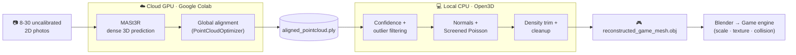

<div align="center">

# 🏙️ Scene Reconstruct

### Turn random internet photos of a place into a walkable 3D game level.

An automated **3D spatial computer-vision pipeline** that takes uncalibrated 2D photos of a
real-world location — different cameras, angles, and lighting, no lens metadata — and
reconstructs them into a solid, watertight 3D mesh ready for a game engine.

[](https://www.python.org/)
[](https://github.com/naver/mast3r)
[](https://www.open3d.org/)
[](LICENSE)

[](https://colab.research.google.com/github/sandeep0608/scene-reconstruct/blob/main/notebooks/stage12_mast3r_colab.ipynb)

</div>

---

> **Why this is hard:** traditional photogrammetry needs the exact focal length and sensor
> size of each camera (EXIF data) to reconstruct 3D. Scraped internet photos don't have
> consistent metadata, so classic tools fail. This pipeline bypasses that by chaining a
> **3D Vision Transformer (MASt3R)** for geometry prediction with a **CPU geometry engine
> (Open3D)** for meshing — no calibration required.

## 🔭 How it works



| Stage | What happens | Where it runs |
|:-----:|--------------|:-------------:|
| **1. Input** | 8–30+ photos of one place, any camera / resolution | — |
| **2. Predict & align** | MASt3R predicts a dense 3D pointmap per image pair; `PointCloudOptimizer` fuses them into one metric coordinate space, recovering every camera's position | ☁️ Cloud GPU |
| **3. Filter & mesh** | Drop low-confidence points (sky/blur), remove floating outliers, estimate surface normals, run Screened Poisson reconstruction | 💻 Local CPU |
| **4. Export** | Watertight `.obj` mesh (+ color-safe `.ply`) ready for Blender → your game engine | 💻 Local CPU |

## ⚙️ Why the two-environment split

The two halves want different hardware, so the pipeline is deliberately split:

- **Stage 2 (MASt3R)** is PyTorch + CUDA — it needs an **NVIDIA GPU**, which you get for free on Google Colab.
- **Stage 3–4 (Open3D)** is pure CPU geometry — it runs locally on any modern laptop, no GPU needed.

> This design means the pipeline works even on machines **without an NVIDIA GPU** (e.g. AMD
> integrated graphics): the heavy ML runs in the cloud, the geometry runs on your CPU, and
> it costs nothing.

## 🚀 Quickstart

### Stage 1–2 — reconstruct (Google Colab)

1. Click the **Open In Colab** badge above (or upload `notebooks/stage12_mast3r_colab.ipynb`).
2. **Runtime → Change runtime type → GPU** (a free T4 works).
3. **Runtime → Run all**, and upload 8–30 photos when prompted.
4. It downloads **`aligned_pointcloud.ply`**.

> For more than ~15 photos, set `SCENE_GRAPH = 'swin-3'` in the reconstruction cell — it keeps
> the pair count (and GPU memory) manageable on a free T4.

### Stage 3–4 — mesh (local)

```bash
python -m venv .venv
.venv\Scripts\activate            # Windows   •   source .venv/bin/activate  on macOS/Linux
pip install -r requirements-local.txt

python scripts/stage34_mesh.py --input path/to/aligned_pointcloud.ply
```

Outputs land in `output_mesh/`. Preview the result with no extra install:

```bash
python -c "import open3d as o3d; m=o3d.io.read_triangle_mesh('output_mesh/reconstructed_game_mesh.ply'); m.compute_vertex_normals(); o3d.visualization.draw_geometries([m])"
```

## 🎛️ Tuning the mesh

The mesh is only as good as the point cloud and these knobs — re-running is seconds:

| Symptom | Fix |
|---------|-----|
| Blobby / ballooned surface | raise `--density-quantile 0.08` |
| Too many holes / too little kept | lower `--density-quantile 0.01` |
| Too smooth, missing detail | raise `--poisson-depth 11` |
| Floating junk remains | lower `--std-ratio 1.2` |
| Out of RAM / too slow | `--poisson-depth 8` or `--voxel 0.02` |

## 📁 Project structure

```
scene-reconstruct/
├── notebooks/
│   └── stage12_mast3r_colab.ipynb   # Stage 1-2 — photos → point cloud (Colab GPU)
├── scripts/
│   └── stage34_mesh.py              # Stage 3-4 — point cloud → game mesh (local CPU)
├── input_images/                    # your photos
├── output_mesh/                     # .obj + .ply outputs
├── requirements-local.txt
└── README.md
```

## ⚠️ Licensing

- **This repository's own code** is released under the **MIT License**.
- **MASt3R** (the model used in Stage 2) is licensed **CC BY-NC-SA 4.0 — non-commercial only.**
  That's fine for a portfolio or personal project, but you may **not** use MASt3R, or meshes it
  produced, in a commercial product without permission.
- **Going commercial?** Swap Stage 2 for [**VGGT**](https://github.com/facebookresearch/vggt),
  which ships a commercial-use checkpoint and fills the same role. The Stage 3–4 script is
  unchanged — it just needs a point cloud.

## 🙏 Acknowledgements

- [**MASt3R**](https://github.com/naver/mast3r) & [**DUSt3R**](https://github.com/naver/dust3r) — NAVER Labs Europe
- [**Open3D**](https://www.open3d.org/) — 3D data processing

## 👤 Author

**Sandeep Tharakaram** · [github.com/sandeep0608](https://github.com/sandeep0608)

Built as a 3D-vision learning + portfolio project. Contributions and ideas welcome!
